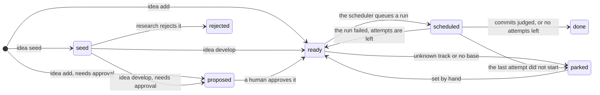
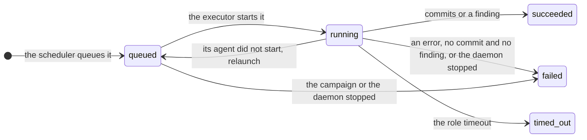
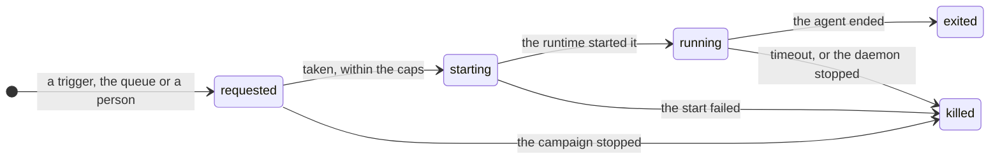
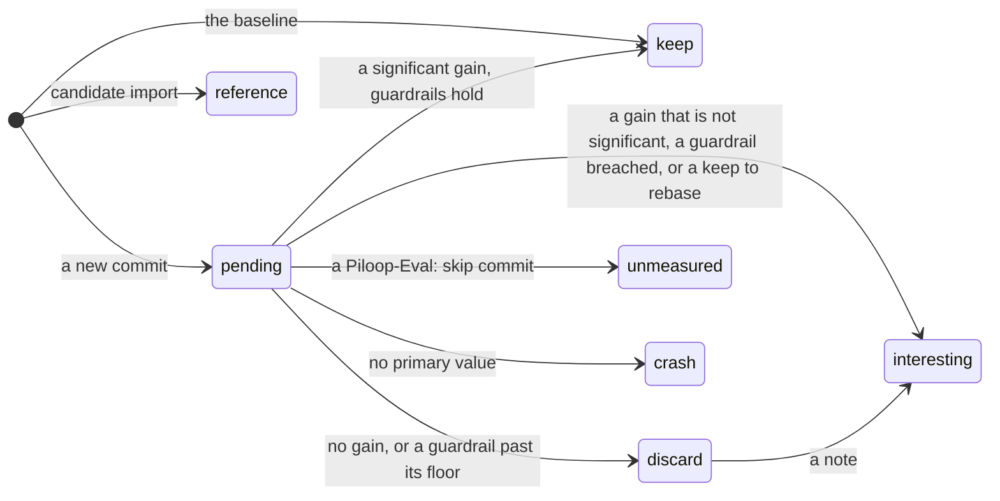

Four columns hold a lifecycle: `ideas.status`, `runs.status`, `workers.state` and `candidates.verdict`. A CHECK
constraint fixes the set of values of each one. piloop has no table of allowed transitions: the daemon and the CLI
take the paths below. Anyone with `piloop sql` can set any value, for example to park an idea or to change a verdict.

These are the values, generated from the enums in `piloop/db/models.py`:

{/* Generated by scripts/gen_docs.py up to the end marker. Do not edit this part: run `make docs`. */}

| Enum | Column | Values |
|---|---|---|
| `IdeaStatus` | `ideas.status` | `seed`, `proposed`, `ready`, `scheduled`, `done`, `parked`, `rejected` |
| `RunStatus` | `runs.status` | `queued`, `running`, `succeeded`, `failed`, `timed_out` |
| `WorkerState` | `workers.state` | `requested`, `starting`, `running`, `exited`, `killed` |
| `Verdict` | `candidates.verdict` | `pending`, `keep`, `interesting`, `discard`, `crash`, `reference`, `unmeasured` |

{/* End of the generated part. */}

## Idea

A newer idea that `supersedes` a `seed`, `proposed` or `ready` idea that never ran makes the daemon reject it. You,
the orchestrator and research also park or reject ideas by hand. See [Ideas, seeds and runs](/concepts/ideas-and-runs).

## Run

A run that the daemon stopped is not counted as an attempt. Its idea goes back to `ready`.

## Agent

A `workers` row is an agent process of any role. While it is `requested`, the row is a request to start one.

## Candidate verdict

The daemon sets a verdict once. Anyone may change it later, and should say why in a comment. See
[the verdict](/concepts/verdict).
