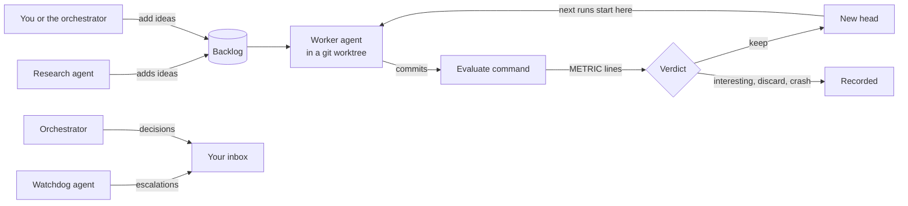

piloop is an autoresearch tool for any git repo. You give it a goal that a program can measure. Coding agents (Claude
Code, Codex or pi) then try ideas in parallel, each one in its own git worktree. piloop scores every commit with your
evaluate command. It keeps a change only when the change beats the best result so far with statistical confidence.

## Why piloop

A coding agent can try an idea in minutes. A hundred ideas need bookkeeping: which idea ran on which code, what it
scored, and whether the gain is real or noise. piloop does this bookkeeping for you.

- **Every commit is scored.** piloop runs your evaluate command in a clean checkout of each commit. An agent cannot
  report its own score.
- **A gain must be real.** piloop compares each result with the best one so far. When your evaluate command reports
  results per example, piloop uses a paired bootstrap, so a gain that comes from a few lucky examples is not kept.
- **Guardrails are enforced.** A second metric, such as latency or size, can get worse only by a margin that you set,
  and never past a floor.
- **Agents work in parallel.** Each worker has its own worktree. A research agent keeps the backlog full. A watchdog
  agent looks for problems.
- **You do not have to wait at the screen.** An orchestrator agent answers what the other agents escalate. It records
  each decision in your inbox, so you can review and revert it later.
- **Everything stays local.** The state is one SQLite database and the git refs in your repo. piloop has no server.

## How a campaign works

1. You, the orchestrator or the research agent add **ideas** to the backlog of the **project**.
2. The daemon, `piloop serve`, starts a **worker** for each ready idea, up to a limit that you set. Each worker is a
   coding agent in a git worktree of the **head**, the best result so far.
3. The worker implements the idea and commits.
4. The daemon runs the **evaluate command** in a clean worktree of each commit. The command prints one
   `METRIC <name>=<value>` line for each metric.
5. The daemon gives the commit a **verdict**: `keep`, `interesting`, `discard` or `crash`. A `keep` becomes the new
   head, and the next runs start from it.
6. The **watchdog** looks for problems. The **research** agent adds ideas when the backlog is short. The
   **orchestrator** answers escalations and records each decision in your **inbox**.

## Requirements

- Linux or macOS.
- git, with a commit identity (`git config user.email`).
- [uv](https://docs.astral.sh/uv/). The installer installs it.
- At least one coding agent CLI, logged in: [Claude Code](https://code.claude.com),
  [Codex](https://github.com/openai/codex) or [pi](https://github.com/badlogic/pi-mono).
- Optional: [Herdr](https://herdr.dev), to see every agent in a terminal pane. Without it, set
  `runtime = "subprocess"` and the agents run in the background.
- Optional: [Entire](https://github.com/entireio/cli), to keep the session of every agent in your repo.

## Next steps

<CardGroup cols={2}>
  <Card title="Quickstart" icon="rocket" href="/quickstart">
    Install piloop and run a campaign that compresses Wikipedia text.
  </Card>
  <Card title="Set up your own repo" icon="wrench" href="/setup">
    Let a coding agent set up a campaign for your repo, or do it by hand.
  </Card>
  <Card title="Concepts" icon="book" href="/concepts/projects">
    Projects, ideas, runs, candidates and the verdict.
  </Card>
  <Card title="CLI reference" icon="terminal" href="/reference/cli">
    Every `piloop` command.
  </Card>
</CardGroup>
