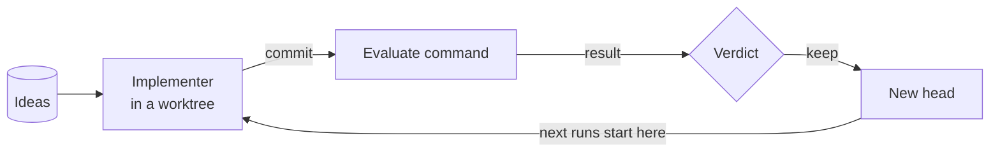

piloop runs coding agents on a goal that a program can measure. Each agent tries one idea in its own checkout of your
repo, and submits the commits that it would ship. piloop scores each with your evaluate command, and keeps a change only
when it beats the best result so far.


The enwik8 example after 10 runs: Claude Code agents took the first 10 MB of Wikipedia from 3,688,770 bytes (zlib) to
2,361,893 bytes (−36%) in 1.6 hours.

## Start

```bash
curl -fsSL https://raw.githubusercontent.com/hiloopai/piloop/main/install.sh | sh
```

Open your coding agent in your repo and tell it what to improve:

```text
Use piloop to make our tokenizer faster without changing its output.
```

The agent sets up the campaign, starts it, and answers for you while it runs. See the [Quickstart](/quickstart).

## How a campaign works



1. You, your agent or the research agent add **ideas** to the **campaign**: one repo, one goal.
2. The **daemon**, `piloop serve`, starts an **implementer** for each open idea. An implementer is a coding agent
   (Claude Code, Codex or pi) in a **worktree**: its own checkout of the **head**, the best result so far.
3. The implementer commits. The daemon runs your **evaluate command** on the commit. The command writes one JSON line
   with each metric to `$PILOOP_RESULT_FILE`.
4. The **verdict** is `keep` when the gain is real and no guardrail metric gets worse than you allow. A keep is the new
   head.
5. A watchdog agent looks for problems. Your agent, the **orchestrator**, answers what the other agents escalate, and
   records each decision in your **inbox**.

## Why piloop

- **No agent scores its own work.** piloop runs the evaluate command in a clean checkout of each commit.
- **A gain must be real.** When the evaluate command reports a result for each example, a paired bootstrap rejects a
  gain that comes from a few lucky examples.
- **Guardrails hold.** A second metric, such as latency, can get worse only by the margin that you set.
- **Your state stays local.** piloop keeps a SQLite database in `~/.piloop` and git refs in your repo. It has no
  hosted service and no account. The agents send your code and prompts to their model providers, as they do when you
  use them yourself.

## Requirements

- Linux (x86-64 or ARM, glibc 2.28 or later) or macOS on Apple silicon. On an Intel Mac, installing builds
  [covalence](https://pypi.org/project/covalence/) from source, which needs a recent Rust.
- git 2.40 or later.
- [uv](https://docs.astral.sh/uv/). The installer installs it.
- At least one of [Claude Code](https://code.claude.com), [Codex](https://github.com/openai/codex) or
  [pi](https://github.com/badlogic/pi-mono), logged in. The agent that you talk to can also be Gemini CLI or Cursor.

## Next steps

<CardGroup cols={3}>
  <Card title="Quickstart" icon="rocket" href="/quickstart">
    Your first campaign, through your agent.
  </Card>
  <Card title="Run a campaign by hand" icon="terminal" href="/by-hand">
    The same steps with the CLI, on the enwik8 example.
  </Card>
  <Card title="Concepts" icon="book" href="/concepts/campaigns">
    Campaigns, ideas, runs and the verdict.
  </Card>
</CardGroup>
