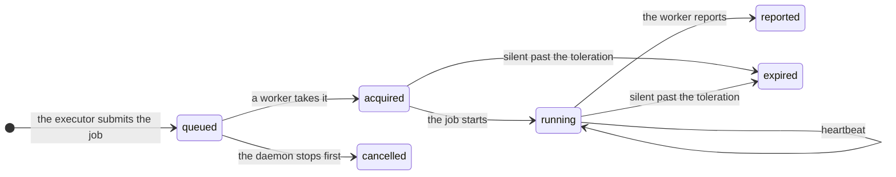

import ExampleInlineExecutor from '/snippets/generated/example-inline-executor.mdx';
import ExampleSqliteCas from '/snippets/generated/example-sqlite-cas.mdx';
import CasProviders from '/snippets/generated/cas-providers.mdx';
import ContractExecutor from '/snippets/generated/contract-executor.mdx';
import ContractNetwork from '/snippets/generated/contract-network.mdx';
import ContractProvisioner from '/snippets/generated/contract-provisioner.mdx';
import ContractCas from '/snippets/generated/contract-cas.mdx';
import ContractVcs from '/snippets/generated/contract-vcs.mdx';
import ContractSecrets from '/snippets/generated/contract-secrets.mdx';
import ContractNotifier from '/snippets/generated/contract-notifier.mdx';
import ContractArchive from '/snippets/generated/contract-archive.mdx';
import ContractMemory from '/snippets/generated/contract-memory.mdx';

These capabilities are host capabilities: their providers get live objects of piloop. Most are the home's choice, in
`$PILOOP_HOME/config.toml`, and take effect at `piloop restart`. The VCS and memory are a campaign's, in `piloop.toml`.

## Executors

An **executor** decides where each job runs: an agent session or an evaluation. The daemon submits the job, and the
executor reports how it ended.

### Example: run each job in a thread of the daemon

<ExampleInlineExecutor />

Select it in `$PILOOP_HOME/config.toml`, then run `piloop restart`:

```toml
[plugins.executor]
provider = "inline"
```

### The contract

The entry point names a subclass of `ExecutorConfig`: its fields are the other keys of `[plugins.executor]`. The
daemon calls its `open(host)` once, when it starts, to make the `Executor`. The live
[limits](/guides/workers#capacity) reach it through `configure`, and a [network](#networks) says who may call
the routes of its [contribution](/plugins/contributions#routes-and-consumers).

<ContractExecutor />

A job's end goes to `host.results`: `finished` or `lost`, in a session that the executor commits. Core raises
`Settled` for a job whose row is closed already. An executor whose workers can report late uses
[leases](#leases) to refuse those reports; `inline` needs none. `run_agent` and `run_evaluation` run one
job on this machine.

### Built in

`workers`, the default, runs every job on a [lease](#leases), taken by its worker in `piloop serve` or by
a [worker on another machine](/guides/workers). Its routes are the lease calls. Its
keys are in the [configuration reference](/reference/configuration#plugins).

### Leases

A **lease** is a time-limited claim on one job by one worker. Any executor can use leases: `Leases` in
`piloop.capabilities`. `workers` runs every job on one.



| Word | Meaning |
|---|---|
| Job | One agent session or one evaluation: what to check out, what to run, what to bring back. It is a blob in the CAS, and its lease names it by address. Its commit, its inputs and its results go by address too. |
| Worker | A process that takes leases and runs their jobs. `piloop serve` has one, called `serve`. |
| Heartbeat | The worker renews its leases every `renew_seconds`. |
| Fencing token | The lease id. It grows with each new lease of a job, and a report with an old one is refused. |
| Revoke | A kill or a cancel: the worker stops the job, and the job still reports. |
| Message | An event that a worker reads after its cursor, with a long-poll: a job waits, stop a job, or a prompt for an agent. A restart of either side loses none. |

[Workers](/guides/workers) sets up pools and says what happens when a worker goes silent.

## Networks

A **network** says how other machines reach the server of `piloop serve --listen`, and who each caller is. Only an
executor with routes needs one.

### Example: trust a tailnet

This network is `https`, and it lets every caller from one address range act without a token:

```python
from collections.abc import Mapping
from ipaddress import IPv4Network, IPv6Network, ip_address, ip_network

from piloop.capabilities import Access, Caller, Https, HttpsNetwork, NetworkHost, Peer, Refused


class Trusted(Https):
    """``trusted``: ``https``, and a caller from ``cidr``, such as a tailnet, may act without a token."""

    cidr: str = '100.64.0.0/10'

    def open(self, host: NetworkHost) -> HttpsNetwork:
        return TrustedNetwork(host, self, ip_network(self.cidr))


class TrustedNetwork(HttpsNetwork):
    def __init__(self, host: NetworkHost, config: Https, trusted: IPv4Network | IPv6Network) -> None:
        super().__init__(host, config)
        self.trusted = trusted

    def identify(self, headers: Mapping[str, str], peer: Peer) -> Caller | Refused:
        if peer.address is not None and ip_address(peer.address.host) in self.trusted:
            return Caller(name=peer.address.host, access=Access.ACT)
        return super().identify(headers, peer)
```

```toml
[project.entry-points."piloop.networks"]
trusted = "my_package:Trusted"
```

```text
[plugins.network]
provider = "trusted"
listen = "0.0.0.0:8443"
tls = "proxy"
```

### The contract

The entry point names a subclass of `NetworkConfig`: its fields are the other keys of `[plugins.network]`. Its
`client` finds this machine's credential itself, or raises `NoCredential` with what to set: `piloop worker` dials with
it. The daemon calls its `open(host)` once, when it starts, to make the server's `Network`. A request that `identify`
refuses gets 401.

<ContractNetwork />

### Built in

`https`, the default, knows no caller other than the tokens of `piloop token`, and its client sends the one in
`PILOOP_HTTPS_TOKEN`. An address that is not loopback needs `tls`: a certificate, or `"proxy"` when a reverse proxy or
an SSH tunnel ends TLS. Its keys are in the
[configuration reference](/reference/configuration#plugins).

## Provisioners

A **provisioner** starts and stops workers on a platform, for a pool whose jobs wait. A pool's
`[plugins.executor.pools.<name>.provisioner.compute]` table selects it: there is no default.
[Workers that the server starts](/guides/workers#workers-that-the-server-starts) sets one up.

### Example: workers in Docker containers

```python
import os
import subprocess
from collections.abc import Sequence

from piloop.capabilities import Instance, InstanceState, Launch, ProvisionerConfig, ProvisionerHost, Provisioning


class Docker(ProvisionerConfig):
    """``docker``: each worker is a container of ``image`` on this machine."""

    image: str

    def open(self, host: ProvisionerHost) -> Provisioning:
        return Containers(self.image, host.owner)


class Containers:
    def __init__(self, image: str, owner: str) -> None:
        self.image, self.owner = image, owner

    def list(self) -> Sequence[Instance]:
        listed = subprocess.run(
            ['docker', 'ps', '-a', '--filter', f'label=piloop.owner={self.owner}',
             '--format', '{{.Names}} {{.Label "piloop.pool"}} {{.State}}'],
            capture_output=True, text=True, check=True,
        ).stdout.split('\n')
        states = {'created': InstanceState.PENDING, 'running': InstanceState.RUNNING}
        return [
            Instance(name=name, pool=pool, state=states.get(state, InstanceState.ENDED), handle={})
            for name, pool, state in (line.split() for line in listed if line)
        ]

    def start(self, launch: Launch) -> None:
        env = {name: value.get_secret_value() for name, value in launch.env.items()}  # never in the argv
        subprocess.run(
            ['docker', 'run', '-d', '--name', launch.name, '--label', f'piloop.owner={self.owner}',
             '--label', f'piloop.pool={launch.pool}', *(f'--env={name}' for name in env), self.image, *launch.argv],
            env=os.environ | env, check=True,
        )

    def stop(self, name: str) -> None:
        subprocess.run(['docker', 'rm', '-f', name], capture_output=True, check=False)
```

The worker's credential goes to `docker` in its environment, never in its argv. Entry point group:
`piloop.provisioners`.

The provider's `open` makes its live side, which lists, starts and stops instances. It tags each instance with the
server's id, and lists only those, so two servers on one account never stop each other's.

<ContractProvisioner />

`modal` is built in. It needs the `modal` extra: `uv tool install --reinstall 'piloop[modal]'`.

## CAS providers

The **CAS** is the content-addressed store that archived files and manifests live in. A provider decides where its
blobs go: a directory, a bucket, or a cache over another provider.

### Example: covalence's SQLite store

This provider keeps the blobs in one SQLite file. Its store is covalence's `Cas.sqlite`, as it is:

<ExampleSqliteCas />

Install it, then select it in `$PILOOP_HOME/config.toml` and restart the daemon (`piloop restart`):

```toml
[plugins.cas]
provider = "sqlite"
path = "/var/lib/piloop/blobs.sqlite"
```

### The contract

A provider is a pydantic model, a subclass of `CasProvider`: the name of its entry point is its `provider`, and its
fields are the other keys of `[plugins.cas]`. A key whose value is another provider's table, as the `remote` of
`cached`, is a `Annotated[CasProvider, CAS.entry]` field.

The store is a `Cas`: the methods of covalence's Python `Cas` that piloop calls, with the same signatures, so a
`covalence.Cas` is a store as it is. A blob's address is a raw BLAKE3 CID of its content. A missing blob reads as
`None`, and bytes that do not match their CID raise covalence's `IntegrityError`. A store with a local tier over a
remote one also implements `Upkeep`, which `piloop store` and the daemon's hourly upkeep use. A store that can be such
a local tier is `Evictable`. Its provider is a `LocalProvider`, and an `Annotated[LocalProvider, CAS.entry]` key, as
`cached`'s `local`, takes only those.

<ContractCas />
 `ObjectsCas` (`piloop.plugins.cas.kit.objects`) is a store of
compressed objects over anything that puts, opens and finds whole files by key: `disk`, `s3` and `gcs` are three.

`check_cas(cas, scratch)` runs the contract against a store, as piloop's tests do with each built-in provider and
with covalence's `Cas.memory()`. It never deletes, so point it at a store that you can empty.

### Built in

<CasProviders />

## VCS

The **VCS** provider keeps a campaign's versions: it saves, merges, checks out and moves them between machines
through the CAS. `[plugins.vcs]` in `piloop.toml` selects it. `git`, built in, is the default and the only one.

Most changes start from `git` and change one method. This one adds a line to the implementers' brief on how to save
their work:

```python
from piloop.capabilities import Git, Part


class SignedGit(Git):
    """``signed_git``: ``git``, and the implementers sign each commit."""

    def prompt(self, part: Part) -> str:
        text = super().prompt(part)
        return text + '\n\nSign each commit: `git commit -S`.' if part is Part.SAVE else text
```

```toml
[project.entry-points."piloop.vcs"]
signed_git = "my_package:SignedGit"
```

<ContractVcs />

## Secrets

The **secrets** provider stores the values of `piloop secret set`. `[plugins.secrets]` in `config.toml` selects it.
`local`, built in and the default, keeps them in the home's database. piloop records who set a secret and when as
events, so a provider stores only the values.

```python
import os
from collections.abc import Collection

from pydantic import SecretStr
from sqlalchemy.orm import Session

from piloop.capabilities import LocalSecrets, Owner


class EnvFallback(LocalSecrets):
    """``env_fallback``: ``local``, and a home secret that it lacks comes from the daemon's environment."""

    def get(self, s: Session, owner: Owner, names: Collection[str]) -> dict[str, SecretStr]:
        found = super().get(s, owner, names)
        if owner is None:
            found |= {name: SecretStr(os.environ[name]) for name in names if name not in found and name in os.environ}
        return found
```

```toml
[project.entry-points."piloop.secrets"]
env_fallback = "my_package:EnvFallback"
```

<ContractSecrets />

## Notifiers

A **notifier** sends the inbox items that need a human to a service outside piloop. `[plugins.notifier.<name>]`
configures one, and `[plugins.notifier] use` names those in use: a campaign's `piloop.toml` over the defaults of
`config.toml`. `slack`, built in, posts to an incoming
webhook, and `slack_app` posts as an app and takes answers back. [Notifications](/guides/notifications) shows their
keys. `send` gets the notices of one campaign, and the secrets of that campaign over the home's. It says what each
notice became: its post, or None when the service gives no id. Or it raises
`NotDelivered`, and piloop retries. piloop records which items it sent, and reminds.

A notifier that also has `listen` (`Listens`) takes answers back. `listen` returns a lifecycle that the daemon starts
and stops. `connection` names what it connects with, never a secret: the instances with the same one share one
listener. For each answer, it calls `host.received` with an `Inbound`: the post whose thread it is in, the message,
the service's user, and a `Reply`, `Ack`, `FileSeed`, `Edit` or `Choose`. piloop maps the post to its item, asks `person` of the
notifier that posted it who the user is, writes what it asks as that person,
and returns `Accepted` or `Declined`, each with what to tell the person, `Answered` for a choice on an escalation
that someone answered already, `Again` for a redelivery, or `Foreign` for a thread that is not piloop's.

```python
from collections.abc import Sequence
from urllib.error import URLError
from urllib.request import urlopen

from piloop.capabilities import MessageRef, NotDelivered, Notice, Notifier, SecretReader


class Ntfy(Notifier):
    """``ntfy``: one push to an ntfy.sh topic."""

    topic: str

    def send(self, notices: Sequence[Notice], secrets: SecretReader) -> Sequence[MessageRef | None]:
        text = '\n'.join(f'{n.campaign}: {n.comment_kind} comment#{n.comment}' for n in notices)
        try:
            urlopen(f'https://ntfy.sh/{self.topic}', data=text.encode(), timeout=10).close()
        except URLError as e:
            raise NotDelivered(str(e)) from e
        return [None] * len(notices)
```

```toml
[project.entry-points."piloop.notifiers"]
ntfy = "my_package:Ntfy"
```

<ContractNotifier />

## Archive

The **archive** moves the finished parts of campaign workspaces into the CAS, and writes them back on
`piloop restore`. `[plugins.archive]` in `config.toml` selects it. `local`, built in and the default, records each
archiving in its `archives` table. Its archiver is a [consumer](/plugins/contributions#routes-and-consumers) of the
daemon's loop. [The archive and the CAS](/concepts/archive) describes what it does. `local`, in
[`piloop/plugins/archive/local/`](https://github.com/hiloopai/piloop/tree/main/piloop/plugins/archive/local), is
the model for another provider.

<ContractArchive />

## Memory

The **memory** provider keeps what past campaigns leave for the next ones. `[plugins.memory]` in `piloop.toml` selects
it. `local`, built in and the default, has the `lessons`, `documents` and `journal` tables, the `piloop journal`
command and its route: [Tables, commands, routes and consumers](/plugins/contributions) shows how. Its contract has one method,
`sync`. [Memory](/concepts/memory) describes it.

This provider is `local` with other default documents:

```python
from piloop.capabilities import LocalMemory


class Evidence(LocalMemory):
    """``evidence``: ``local``, and the documents are the reports under ``docs/evidence/`` unless the table says else."""

    documents: list[str] = ['docs/evidence/**/*.md']
```

```toml
[project.entry-points."piloop.memory"]
evidence = "my_package:Evidence"
```

<ContractMemory />

## Campaign types

A **campaign type** is what one kind of campaign stores, and `campaigns.type` names it. `optimization`, built in, is
the research model: its schema has the ideas, runs, candidates and evaluations. Every campaign is of this type. Its
contract has no methods.
